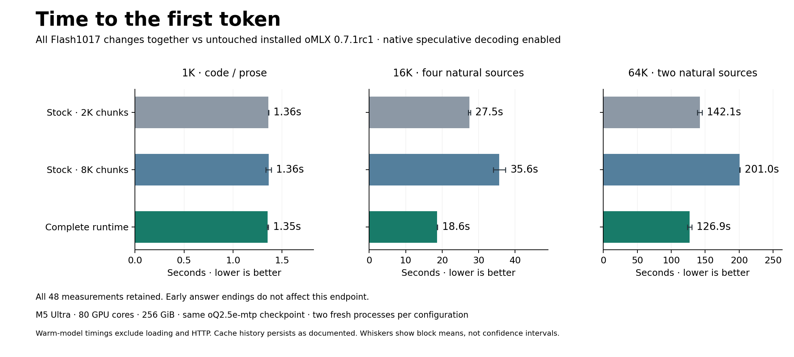

# Flash-1017 on a 256 GiB Mac: 20.1% less time to first token

**Draft for review.** This article reports a prototype benchmark; the installable
build and its validation are described under [Software and reproduction](#software-and-reproduction).

DeepSeek-V4.1-Flash-1017 already runs in oMLX, an inference server built on
Apple's MLX framework. This project asks how much faster a specific checkpoint
can execute on a **256 GiB M5 Ultra Mac Studio**, without changing its weights.
The work combines vocabulary-weight reuse, speculative-decoding changes,
selective decoder computation and caching of disk-backed lookup-table rows.

Across eight workloads, the complete prototype reduced geometric-mean **time
to first token from 19.554 to 15.631 seconds: 20.06% less time**. The reference
was installed **oMLX 0.7.1rc1 with native speculative decoding enabled**. Time to
first token includes processing the prompt and producing the first output;
these measurements exclude model loading and HTTP transport.

The gain varies by workload. One 64K code case regressed, sampled peak memory
increased by **7.75 GiB**, and the complete configuration has not passed a
paired evaluation of answer quality against stock. The [quality evidence](QUALITY.md)
records the small coding checks, including a regression in a rounding-enabled
configuration, and the validation required for a no-quality-loss claim.
The experiment measures a particular release and configuration; upstream
`main` was not benchmarked.

*Two fresh-process blocks per configuration; 48 measured requests in total. The figure's block ranges are not confidence intervals. Timings exclude model loading and HTTP transport.*

## What changed

We used the existing [mlx-community oQ2.5e-MTP checkpoint](https://huggingface.co/mlx-community/DeepSeek-V4.1-Flash-1017-oQ2.5e-mtp/tree/78456115d301eecf9fadcdcc81c0cf6f8b2c8eab),
unchanged. Two parts of execution matter here: **prefill**, which processes the
prompt, and **generation**, which produces output tokens. oMLX's multi-token
prediction (MTP) path uses DeepSeek's DSpark drafter to propose tokens that the
target model verifies together. That is the speculative-decoding path used in
this study.

The complete prototype combines six changes:

- **Vocabulary projection:** reuse BF16 (16-bit floating-point) weights that map model activations
  to vocabulary scores across several verification rows. Each row represents
  one token position; sharing weight loads reduces repeated memory traffic.
- **Attention-output rounding:** apply the reference rounding boundary in both
  the target model and drafter. This selects a numerical behavior, so changes
  in outputs must be evaluated rather than assumed harmless.
- **Confidence scheduling:** use DSpark confidence and a fixed calibrated cost
  policy to choose how many proposed tokens to verify. The drafter proposes
  five tokens; the selected prefix can be shorter, including zero.
- **Prompt chunks and prefetch:** process up to 8,192 prompt tokens per chunk
  and raise the admission budget of oMLX's existing background Engram reader
  from 16 to 64 MiB. Engram is the model's lookup-table component; this
  configuration reads the needed rows from disk.
- **Dependency replay:** compute only the decoder suffixes needed for the
  requested outputs, while preserving the relevant arithmetic and draft state.
- **Row caching:** integrate HotRows with a 256 MiB retained cache for each of
  two disk tables, coordinating reads and releasing model-owned resources on
  unload. This cache is distinct from the server's prompt-prefix cache.

These changes include adaptation of existing community implementations and published techniques. The contribution is the exact-checkpoint integration, concrete numerical diagnosis and repairs, and the measurements showing what did and did not work. The [attribution map](ATTRIBUTION.md) distinguishes copied code, related implementations and local additions.

## Why removing rows was not enough

Some decoder work does not contribute to the final outputs we need. Dependency-aware replay computes progressively smaller suffixes instead. That idea already appears in [ds4](https://github.com/antirez/ds4/blob/fc80bd695da76ee14bcb86820bf900a5cdfda806/ds4.c#L42408) and related MLX work.

The difficult part was preserving the intended floating-point computation. The number of token rows can determine which GPU kernel runs. Removing mathematically unnecessary rows can therefore change rounding in the rows that remain.

One concrete example appeared at the final mixture-of-experts layer, where each token is routed to a subset of expert networks. A replay suffix had **255 rows**. With six selected experts per row and 384 experts, that produced 1,530 routes—just below a grouped-kernel dispatch threshold of 1,536. Adding one temporary zero row crossed the threshold and restored the relevant dispatch behavior. The implementation discards that extra output row; it does not add a token to attention or the cache. This was a targeted repair for a known model layout, not a general instruction to pad every calculation.

We also found that matching the target model's state was insufficient. DSpark needs its own cached prompt context. The target state could match while the drafter's circular state buffers differed. The final implementation preserves the relevant arithmetic in all three draft-stage projections, crops before the subsequent normalization and cache append, and checks that priming completes. That is why the tests inspect both target and draft state, as well as generated tokens.

These checks support the tested execution paths. They are not a universal equivalence proof for every model, shape or request.

## The complete comparison

All three configurations used the same downloaded weights, hardware and embedded dependency environment. Both stock configurations used native adaptive MTP with a maximum draft depth of three and the standard 16 MiB prefetch budget. The complete configuration included all changes listed above, including its five-token draft width and numerical policy.

| Configuration | Prompt chunks | First-token time, geometric mean | Sampled peak process footprint |
|---|---:|---:|---:|
| Installed oMLX, native MTP | 2,048 | 19.554 s | 208.35 GiB |
| Same installed runtime and MTP | 8,192 | 24.293 s | 215.77 GiB |
| Complete prototype | 8,192 | **15.631 s** | **216.10 GiB** |

Widening chunks alone increased aggregate latency. The reported 20.06% reduction uses the faster stock configuration, with 2,048-token chunks, as its reference.

This is a custom latency suite: two synthetic 1K code/prose cases, four natural-source 16K cases, and two 64K cases, using CPython, curl, *Moby-Dick* and *Pride and Prejudice*. These inputs exercise execution; they are not scored tasks from a standardized answer-quality benchmark. Exact input tokens were frozen. Each configuration ran in two fresh processes; the second block reversed configuration and case order. Six warmups were excluded. Models remained loaded and OS caches were not purged during measurement. Each request had fresh conversation state, and the candidate's row cache persisted through the declared measured sequence.

At 16K, aggregate first-token time fell **32.19%**. At 1K, it changed only **0.60%**. The 64K CPython case became **2.32% slower** to first token, from 102.073 to 104.445 seconds. The complete configuration also used more memory. The stock configuration with 8,192-token chunks had a similar footprint, so the full 7.75 GiB difference from stock 2K cannot be assigned to the 512 MiB retained-row cache.

## Why we report first-token latency rather than full-answer speed

The benchmark requested 512 generated tokens with stopping disabled. **Nine requests emitted an end-of-sequence (EOS) token before output token 512: three in each configuration.** The acceptance rule required the full measured output interval to precede EOS, so the 512-token endpoint failed that rule. Continuing computation after the model signals the end of an answer cannot establish useful answer-completion speed.

All observations remain in the archive. Prefill and first-token measurements satisfy their separate checks because they precede EOS. A supplementary analysis found **20.21% less time to token 128**, with every observed prefix preceding EOS. That analysis is **post hoc** and uses delivery timestamps inside the original runs; it is not a new 128-token request benchmark. Forced-512 rates remain descriptive and are not the main performance claim.

The [full report](../archives/2026-10-18-preview/evidence/overall/review/report.txt) includes the protocol, per-case results, resource observations and limitations. Different output streams also mean the complete comparison cannot establish unchanged answer quality or faster equivalent task completion.

## What the component comparisons measure

The overall comparison measures the combined configuration. Two additional
comparisons examine particular components with other settings held fixed:

| Component | Reference and changed configuration | Observation |
|---|---|---|
| **Vocabulary-weight reuse** | Both use reference attention rounding and fixed speculative depth 2. Only the changed configuration enables the weight-reuse kernel. | **7.34% higher geometric-mean generation throughput** across 20 matched pairs; all 10,240 compared output-token positions matched. |
| **Dependency replay plus HotRows** | Both use reference rounding, head reuse through six rows, confidence scheduling, 8,192-token chunks and 64 MiB prefetch. The reference runs the full decoder and bypasses the row cache; the candidate enables repaired replay and HotRows. | **40.33% less prompt-processing time**, 68.828 → 41.073 seconds, across 12 measured pairs; all 1,536 compared output-token positions matched. |

The replay/cache experiment uses a modified reference and a different workload
and cache sequence from the overall comparison. Its 40.33% result therefore
answers a different question from the 20.06% headline. The head study measures
generation throughput, another metric. Adding or multiplying these figures
would not produce a measured overall speedup.

Numerical scope also matters. The weight-reuse implementation for rows 2–5
preserves the existing specialized kernel's arithmetic. Row 6 replaces a
matrix-multiply fallback with six single-row reductions and can differ from
that fallback. The depth-2 study does not test that extension. [Methods and
results](RESULTS.md) defines each configuration, workload and evidence source.

## Software and reproduction

There are two source artifacts. The **benchmark prototype** is the
[source snapshot](../archives/2026-10-18-preview/source/) that produced the
performance results above, running with an installed oMLX application's embedded
environment. The **installable fork**, version `0.7.1rc1+flash1017.1`, integrates
those retained changes into normal oMLX package modules and uses native binaries
from a public release. Those binaries differ from the measured application's
binaries, so the prototype's speedup cannot yet be assigned to the installable
build.

The fork passed clean-installation checks and a real HTTP serving test covering
an 8,319-token prompt, cached-prefix reuse, cancellation/recovery and rejection
of excessive context requests. Its default test suite had **18,054 passes and
12 failures**, with all 12 failures reproduced on the unchanged public release
base. The [validation record](../validation/runtime-preview-01/README.md) binds
those results to an exact commit and wheel. This establishes a functional
preview on the tested machine; performance and answer-quality equivalence for
that build remain unmeasured.

The maintained implementation belongs in the [rubencu/omlx fork](https://github.com/rubencu/omlx).
The research repository supplies the article, [saved-data analyzer](../archives/2026-10-18-preview/analysis/),
raw observations, source snapshots and attribution. The preview branch, wheel
and proposed `rubencu/flash1017-research` remote are prepared locally and await
publication review. [Repository layout](REPOSITORIES.md) describes their roles.

Anyone can verify the saved files and recalculate the overall result with the
[commands in the README](../README.md#inspect-and-recalculate-the-evidence),
without a GPU or model weights. Repeating inference additionally requires the
checkpoint, sufficient memory and the recorded execution environment. The
prototype's application-dependent launcher is not a standalone installer.

The serving profile allows one active request and a **131,072-token total
context limit**, counting prompt and requested output. This limit is a
configuration boundary, not evidence that every request up to it was tested.
The overall timing suite stops at 64K input, and the fork's live validation
reaches 8,319 input tokens. Offline state/output checks at longer lengths do
not demonstrate reliable long-context chat. A separate long-context HTTP test
failed its recovery-response check; its cause was not established and the
remaining cases were not run.

The results give developers an inspectable implementation, concrete examples
of shape-dependent arithmetic and draft-state failures, and measurements with
explicit comparison settings. Runtime improvements can be developed in the
fork; analysis corrections and new experiments can be recorded alongside the
versioned research evidence.
